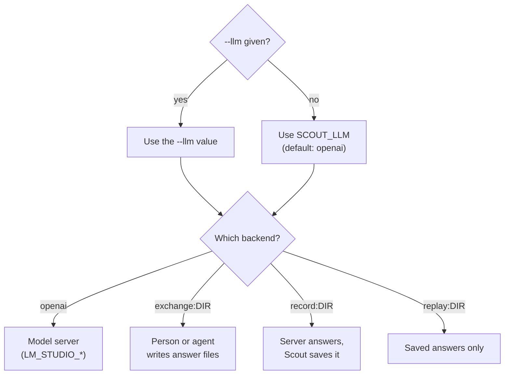
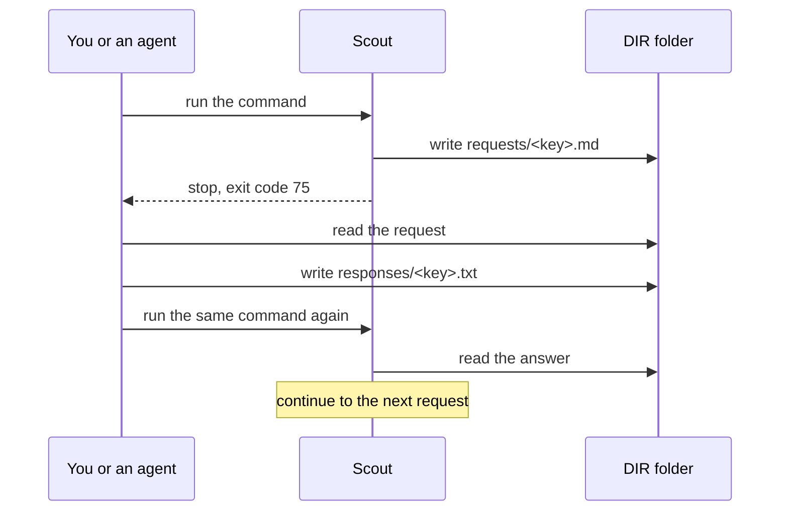
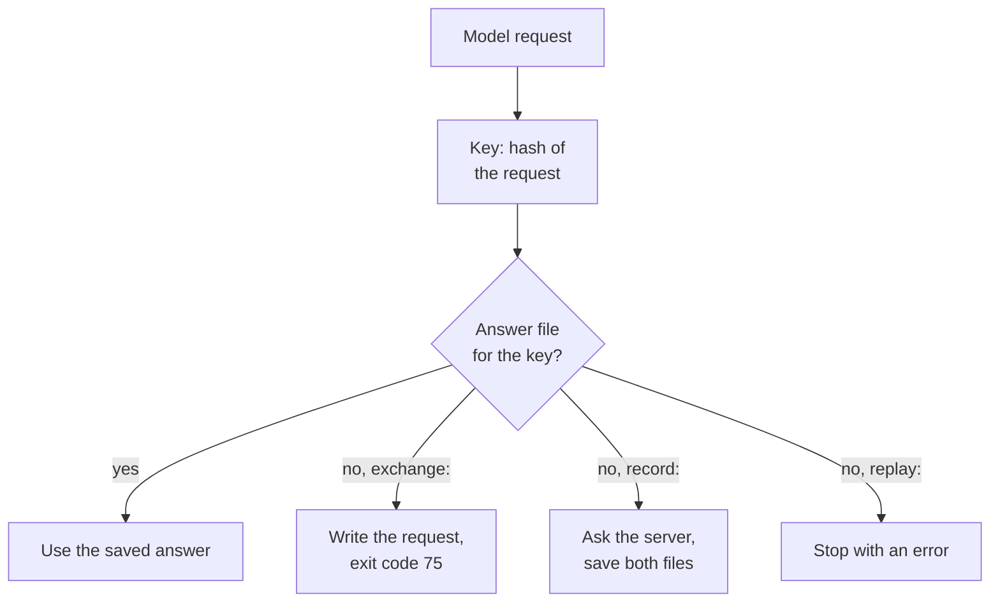
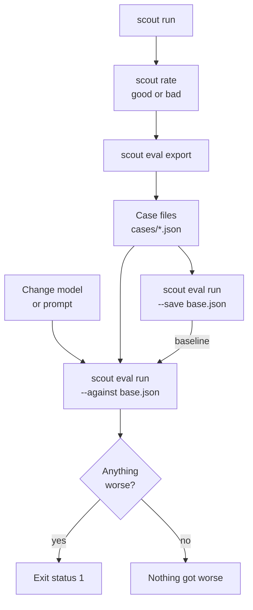

# Models

Scout uses a language model to plan searches, list claims, copy quotes and judge claims. This
page tells how to connect a model, how to test it, and how to compare models and prompts.



The diagram shows how Scout selects the backend that answers each model request.

## Backends

`SCOUT_LLM` selects who answers. `--llm` overrides it for one command.

| `SCOUT_LLM` | Who answers | Use it for |
|---|---|---|
| `openai` (default) | An OpenAI-compatible server: LM Studio, Ollama, llama.cpp or vLLM. The `LM_STUDIO_*` settings configure it. | Daily work with your local model |
| `exchange:DIR` | A person, or an agent such as Claude Code. Scout writes each request to `DIR/requests/<key>.md`. The answer goes to `DIR/responses/<key>.txt`. | An agent as the model, with no model server |
| `record:DIR` | The model server. Scout saves every exchange in DIR. | A record of a real session |
| `replay:DIR` | Only the answers saved in DIR. Scout asks no server. | Offline tests (see [Record and replay](#record-and-replay)) |

### Use another backend for one command

`--llm` overrides `SCOUT_LLM` for one command. These commands take it: `scout run`,
`scout factcheck`, `scout watch run`, `scout replay` and `scout eval run`.

```bash
scout factcheck --cited -f answer.md --llm exchange:./answers
scout replay RUN --llm record:./fixture
```

Rules for the value:

- `exchange:`, `record:` and `replay:` need a folder. Without one, Scout stops with
  `SCOUT_LLM='exchange:' needs a folder, e.g. exchange:./exchange`.
- A relative folder is relative to the folder where you run the command. This is also true when
  the value comes from the `.env` file.
- Any other value stops Scout with `unknown SCOUT_LLM value …`.

## The openai backend

The `openai` backend sends chat requests to a server with an OpenAI-compatible API: LM Studio,
Ollama, llama.cpp or vLLM.

| Variable | What it does |
|---|---|
| `LM_STUDIO_BASE_URL` | The server address (default `http://localhost:1234/v1`). Scout sends requests to `/chat/completions` and gets the model list from `/models` under this address. |
| `LM_STUDIO_MODEL` | The model id. `scout models` lists the ids. |
| `LM_STUDIO_API_KEY` | A token, if the server requires one |
| `SCOUT_PLANNER_MODEL` | A smaller model for the plan step (default: the main model) |
| `SCOUT_MODEL_TTL` | Seconds that LM Studio keeps a model loaded on demand |
| `SCOUT_LLM_TIMEOUT` | Seconds to wait for one reply (default 300) |
| `SCOUT_CONTEXT_TOKENS` | A context window that overrides what the server reports |

[Configuration](configuration.md) gives every setting, with its default.

- **A planner model.** With `SCOUT_PLANNER_MODEL`, a small model plans the searches, and the main
  model reads the pages. Only the plan step goes to the planner model. Results name the main
  model, because it reads the pages.
- **Unload when idle.** With `SCOUT_MODEL_TTL`, Scout tells LM Studio to unload a model that it
  loaded on demand after that number of idle seconds. A daemon that runs every few hours then
  leaves your GPU free between runs. With no value, LM Studio's own setting applies.
- **The context window.** LM Studio tells Scout the context window of the loaded model. Other
  servers do not. Then Scout assumes 8192 tokens, and `scout check` shows the note
  `context not reported; assuming 8192 tokens`. On those servers, set `SCOUT_CONTEXT_TOKENS` to
  the real value. 8192 tokens is the context length that LM Studio (0.4.16 and later) gives a
  model that it loads on demand.
- **Reasoning text.** Some chat templates (DeepSeek, Qwen) leave the model's reasoning in the
  reply, in `<think>` blocks. Scout removes these blocks.
- **Errors.** Scout stops with `cannot reach the model server at URL` when the server does not
  answer. It stops with `no reply from URL within 300s` when a reply takes longer than
  `SCOUT_LLM_TIMEOUT`.

> [!WARNING]
> Your text and the page text go to the server at `LM_STUDIO_BASE_URL`. If that server is not
> on your machine, your text leaves your machine. Keep the server on localhost or on a private
> network. Do not expose it to the internet. See [Privacy](privacy.md).

### Use Scout with LM Studio

1. Start the server in LM Studio.
2. Copy the example settings file: `cp .env.example .env`.
3. In `.env`, set `LM_STUDIO_BASE_URL` to the server address. Scout's default is
   `http://localhost:1234/v1`.
4. Run `scout models` to list the model ids that the server offers.
5. In `.env`, set `LM_STUDIO_MODEL` to one of these ids.
6. If "Require Authentication" is on in LM Studio, create a token under Developer > Server
   Settings.
7. Set `LM_STUDIO_API_KEY` to that token.
8. Optional: set `SCOUT_PLANNER_MODEL` to a smaller model, and `SCOUT_MODEL_TTL` to a number of
   seconds.
9. Run `scout check`. Make sure that it shows your model and its context window.
10. Run a goal:

    ```bash
    scout run "What are the new features in Python 3.13?"
    ```

For Ollama, llama.cpp or vLLM, do the same steps with the address of that server. Also set
`SCOUT_CONTEXT_TOKENS`, because these servers do not report the context window.
`SCOUT_MODEL_TTL` applies to LM Studio only.

## Test the server: scout check

```bash
scout check
```

`scout check` does these steps:

1. It shows the settings that Scout uses.
2. It asks the server for the model's real context window and its reasoning levels.
3. It sends one small request with schema-constrained output, and checks the reply.
4. It remembers the result for a day (24 hours).

| Line | What it shows |
|---|---|
| settings file | The `.env` file that Scout read, or `none (environment only)` |
| model backend | `SCOUT_LLM` |
| server | `LM_STUDIO_BASE_URL` |
| model | `LM_STUDIO_MODEL`, and the idle time from `SCOUT_MODEL_TTL` |
| planning model | `SCOUT_PLANNER_MODEL`, or `the same` |
| API key | `set` or `not set` (never the key itself) |
| search | `SCOUT_SEARCH` |
| JavaScript pages | `SCOUT_RENDER`, or `not rendered` |
| archived copies | `SCOUT_ARCHIVE` |
| data folder | `SCOUT_DATA_DIR` |
| reports folder | `SCOUT_OUTPUT_DIR` |
| the model | `loaded`, `not loaded (loads on first use)` or `unknown` |
| context window | The tokens that Scout plans for |
| structured mode | `json_schema` or `prompt` (see below) |
| reasoning | The reasoning levels that the server reports, or `none reported` |

The last line is a note, for example where the context window came from.

| Structured mode | What it means |
|---|---|
| `json_schema` | The server limits the reply to the JSON schema. It is fast and reliable where it works. |
| `prompt` | The schema goes into the prompt. Scout parses the reply and makes sure that it agrees with the schema. This is the safe default. |

- Models of the gpt-oss family always use `prompt` mode. LM Studio is known to garble their
  schema-constrained output.
- If a reply is not valid, Scout asks the model one time to correct it.
- Other commands use the result of `scout check` for a day. After a day, they ask the server
  again for the context window and the reasoning levels. They do not test schema-constrained
  output again. They keep the structured mode that Scout found before, with the note
  `json_schema mode (kept from before)`. The gpt-oss rule above still applies.
- A run in which `json_schema` output fails changes to `prompt` mode, and Scout remembers this.
  This also stays after a day, until the next `scout check`.
- When the server reports reasoning levels, Scout asks for `low` in the plan step and for
  `medium` in the other steps, if the model has these levels.
- With `exchange:DIR` or `replay:DIR`, `scout check` asks no server. It shows 32768 tokens (or
  `SCOUT_CONTEXT_TOKENS`), `prompt` mode and the note `answered through exchange files`. If DIR
  has a session file from `record:DIR`, it shows the recorded values and the note
  `from the recorded session of DAY (PATH)`. See [The session file](#the-session-file).

> [!NOTE]
> Run `scout check` again after you change the model, the server or `SCOUT_CONTEXT_TOKENS`.
> Only `scout check` tests schema-constrained output.

## List the models: scout models

```bash
scout models
```

`scout models` lists the model ids that the server offers. Use it to find the id for
`LM_STUDIO_MODEL`.

- A dot marks the model in `LM_STUDIO_MODEL`.
- `(planning)` marks the model in `SCOUT_PLANNER_MODEL`.
- It works with `SCOUT_LLM=openai` and with `SCOUT_LLM=record:DIR`. `LM_STUDIO_MODEL` and
  `SCOUT_PLANNER_MODEL` can be empty.
- With `exchange:DIR` or `replay:DIR`, no server answers. Scout then stops with
  `` `models` lists what a model server offers: set SCOUT_LLM=openai or record:DIR ``.

## The exchange backend

With `exchange:DIR`, files are the model API. Scout writes each request to a file. A person, or
an agent such as Claude Code, writes the reply to another file. You need no model server and no
GPU.



The diagram shows one round: Scout stops at a request that has no answer, and continues when
the answer is there.

### The files

| File | Written by | What it holds |
|---|---|---|
| `DIR/requests/<key>.md` | Scout | The request: the step, the model name, the temperature and the answer file. Then each message, under a line such as `===== SYSTEM =====` or `===== USER =====`. |
| `DIR/responses/<key>.txt` | The person or the agent | The reply, as the model would write it, and nothing else |
| `DIR/responses/<key>.reasoning.txt` | Scout, with `record:DIR` only | The reasoning text of the reply, if the server sent one. Some servers put the whole answer there. |
| `DIR/responses/<key>.error.json` | Scout, with `record:DIR` only | The error that the server gave in place of an answer: its kind (for example `ContextOverflow`) and its message |
| `DIR/session.json` | Scout, with `record:DIR` only | What the recorded requests used: the model name, the context window, the structured modes, the reasoning levels and the day. See [The session file](#the-session-file). |
| `DIR/session.json.lock` | Scout, with `record:DIR` only | A lock: one process at a time changes `session.json` |

- **The key** is 16 hexadecimal characters. It is a hash of the model name, the messages, the
  schema and the temperature. The same request always gets the same key, and so the same answer
  file. With `exchange:DIR`, the model name is `exchange`. If DIR has a session file, the model
  name is the recorded name.
- When Scout writes a request, it also makes the folder `DIR/responses/`, ready for the answer.
- The request file tells the answerer: "Write the model's reply, and nothing else, to the answer
  file. Use only the information in the messages below."
- **Most requests want JSON.** The system message then ends with the JSON schema and the
  instruction "Reply with a single JSON object and nothing else (no prose, no code fences)."
  Scout reads the first JSON object in the reply. If the reply is not valid, Scout asks one time
  to correct it. That is a new request, which holds the bad reply and the problem.
- Scout assumes a context window of 32768 tokens for an agent. `SCOUT_CONTEXT_TOKENS` changes
  this. If DIR has a session file, Scout uses the recorded context window.

### Exit code 75: run again to continue

- When a request has no answer file, the command stops with exit code 75. It shows
  `Waiting for the model's answer:`, the path of the request file, and
  `Write the reply to the answer file it names, then run the same command again.`
- Run the same command again to continue. Each time, Scout uses the answers that are there and
  stops at the next request that has no answer. A command that needs many model requests needs
  many rounds.
- The searches and pages that the command read are kept while it waits. So it continues with
  the same prompts, however long the answer takes, up to a day. A run that still waits after a
  day reads the web again.
- The same request gets the same answer file. So a finished check that you ask again costs no
  model time. A claim's judge request in an audit is the same as in a cite-check, so one answer
  (given through `exchange:DIR`, or recorded with `record:DIR`) serves both.
- An audit (`--all`) and the first run of a citation watch also continue where they stopped.
  See [Citations](citations.md) and [Watches](watches.md).
- In the daemon, a watch that waits for an answer goes into the log, and the daemon tries it
  again after 30 minutes.
- Over MCP, the tool returns the error
  `waiting for the model's answer: write it to PATH, then call again`.

### Answer with an agent through the exchange backend

Give these steps to the agent (for example Claude Code). The agent can run the command itself.

1. Select a folder for the exchange, for example `./answers`.
2. Run the command with `--llm exchange:./answers`:

   ```bash
   scout factcheck --cited -f answer.md --llm exchange:./answers
   ```

3. If the exit code is 75, open the request file that the command names.
4. Read the messages. Use only the information in them.
5. Write the reply, and nothing else, to the answer file that the request names
   (`responses/<key>.txt`).
6. Run the same command again.
7. Do steps 3 to 6 again until the exit code is not 75.

To use the exchange backend for all commands, set `SCOUT_LLM=exchange:./answers`.

## Record and replay

`record:DIR` and `replay:DIR` use the same files as `exchange:DIR`. `record:DIR` keeps a record of
a real session with the model server. `replay:DIR` answers only from saved answer files, with no
server. A replay sends the same requests as the recording, so it gets the same answers and gives
the same result.



The diagram shows what each backend does with a model request.

- **`record:DIR`** uses the model server, with all the `openai` settings (the planner model
  too). Scout saves each request and its answer in DIR, with the reasoning text if the server
  sent one. If DIR already has the answer to a request, Scout uses it and does not ask the
  server.
- When the server gives an error in place of an answer, `record:DIR` saves the error. A run can
  continue after some errors: it sends less page text after a prompt that is too long, changes
  to `prompt` mode after a refused schema, and a deep run stops looking further after any
  error. For a request with a saved error, `record:DIR` asks the server again, and saves what
  happens now.
- **`replay:DIR`** answers only from the files in DIR. It asks no server. It gives each saved
  answer exactly, with its reasoning text, and it raises each saved error again. So the replay
  continues as the recorded run did. A request with no answer file stops the command with
  `no recorded answer for the STEP request KEY`.
- `exchange:DIR` also raises a saved error again. To give an answer in its place, write the
  answer file: an answer file wins over a saved error.
- Scout writes each file in one step. If a recording stops, DIR holds no half-written answer.
- A request that changes in any way gets another key, and `replay:DIR` has no answer for it.
  See [What a replay needs](#what-a-replay-needs).

### The session file

A request does not hold only the question. The context window and the page size set how much
page text goes into the prompt. The structured mode puts the JSON schema into the request
(`json_schema`) or into the messages (`prompt`). Each prompt also gives the date. So
`record:DIR` also writes `DIR/session.json`:

```json
{
  "model": "qwen3-8b",
  "context_tokens": 16384,
  "max_page_chars": 6000,
  "structured_modes": ["json_schema", "prompt"],
  "reasoning_options": ["low", "medium", "high"],
  "today": "2026-10-12"
}
```

| Field | What it holds |
|---|---|
| `model` | The model name in the request keys: `LM_STUDIO_MODEL` |
| `context_tokens` | The context window that the requests used |
| `max_page_chars` | The page text for each source: `SCOUT_MAX_PAGE_CHARS` |
| `structured_modes` | The structured modes of the recorded requests |
| `reasoning_options` | The reasoning levels that the server reported |
| `today` | The day of the session (UTC): the day that the first recorded run used |

Scout writes the session file when it records the first request. A command that records
nothing, for example `scout check` with `SCOUT_LLM=record:DIR`, does not write it. Scout ignores
a session file that holds no recorded request.

A recording selects its day one time, before its first run: the day of the session in the
folder, or else the current day. Then it keeps that day, because its prompts give it.

Two processes can record into one folder at the same time, for example the daemon and a
command. Before each change, Scout reads the session file again under a lock, and keeps the
modes of both processes. If the session in the folder has another day than the recording (for
example, two recordings that started before and after midnight), the recording stops with
`the session in DIR was recorded on DAY, and this run asks with DAY: record into a new folder`.

Each run on a folder with a session file uses the day of the session as today. This applies to
`record:DIR`, `replay:DIR` and `exchange:DIR`. The day goes into the prompts. Scout also uses it
to find old news and to set the confidence. The start time of the run stays the real time. So a
replay on a later day sends the same requests and gives the same result.

`replay:DIR` and `exchange:DIR` also use these values of the session file:

- The request keys use the recorded model name, not `exchange`.
- Scout uses the recorded context window, page size and reasoning levels. It asks no server for
  them. The recorded values win over `SCOUT_CONTEXT_TOKENS` and `SCOUT_MAX_PAGE_CHARS`, because
  the keys depend on them.
- A replay starts in `json_schema` mode if a recorded request used it. Else it starts in `prompt`
  mode.
- If a recorded run changed from `json_schema` to `prompt` mode, the replay changes at the same
  step: it gets the same saved error, or the same reply that is not valid.
- After such a run, Scout records the next runs in `prompt` mode only. The session then holds
  both modes. A replay of such a run starts in `json_schema` mode and finds no answer for its
  first request. It then changes to `prompt` mode and finds the recorded answers.

A folder with no session file works as before: the model name is `exchange`, the context window
is 32768 tokens (or `SCOUT_CONTEXT_TOKENS`), the mode is `prompt` and each run uses its own day.

> [!NOTE]
> A folder holds one session: one model, one context window, one page size and one day. A later
> recording into the folder also uses the day of the session, so each recorded request stays
> replayable. If the model, the context window or the page size changes, Scout starts a new
> session with the current day. A replay then does not find the answers that were recorded
> before the change. To record with the current day, use a new folder.

### What a replay needs

The session file gives the model name, the context window, the page size, the structured mode
and the day. A replay also needs these:

- **The same pages.** `scout replay RUN` and `scout eval run` use the stored pages of a run or a
  case, so their prompts do not change. `scout run` and `scout factcheck` search and read the
  web again. Replay them only while the search and page caches still hold the same results.
- **The same settings for search.** `SCOUT_MAX_RESULTS` and `SCOUT_REGION` decide which pages a
  run reads. The session file does not hold them.

If a request is not the same, the replay stops with
`no recorded answer for the STEP request KEY`.

### Make an offline test fixture

An eval case holds the pages that it reads, so its prompts do not change. This makes it a good
fixture.

1. Record the answers of the model server:

   ```bash
   scout eval run cases/ --llm record:./fixture --save base.json
   ```

2. Replay them with no server, on the same day or later:

   ```bash
   scout eval run cases/ --llm replay:./fixture --against base.json
   ```

3. Make sure that the replay shows `Nothing got worse`.

`scout replay RUN` also works with `record:DIR` and then `replay:DIR`.

## Test models and prompts



The diagram shows the loop that finds regressions: a run becomes a test case, the case scores a
model, and later scores are compared with a saved baseline.

### Replay a run: scout replay

```bash
scout replay RUN
scout replay RUN --llm exchange:./answers
```

`scout replay RUN` analyzes a stored run's exact pages again, with any model, and compares. It
does no search and downloads no page.

| Option | What it does |
|---|---|
| `--llm TEXT` | The model to analyze with, for example `record:./fixture` |
| `--json` | Print the new result as JSON |
| `--no-save` | Do not keep the replay as a new run |

- It shows a table with the model, the findings, the trusted findings and the confidence, for
  the run and for the replay. Then it shows the report of the replay.
- The replay is kept as a new run, unless `--no-save`. Its findings do not go into the memory
  (`scout ask`).
- Scout keeps each version of a page that a run read. If a version is gone, the replay says
  `N page(s) of it are no longer stored`.
- A fact-check cannot be replayed. Scout stops with
  `run N is a fact-check: check the text again with scout factcheck`.

### Make a test case: scout eval export

```bash
scout eval export RUN case.json
```

`scout eval export RUN case.json` turns a run into a test case, with the exact pages that it
read. The run's ratings become what the case expects:

| Rating (`scout rate RUN N`) | In the case | Meaning |
|---|---|---|
| `good` | `expect.facts` | A fact that the trusted findings must contain |
| `bad` | `expect.untrusted` | A claim that must never be trusted |

- You can add expected facts by hand under `"expect"` in the JSON file. Scout reminds you:
  `List expected facts under "expect" to measure recall.`
- A case file holds `name`, `goal`, `plan`, `sources` (with the full page text), `expect`, and
  optionally `replies` (model replies for each step). `scout eval export` writes no `replies`.
- A fact-check cannot become a case. A run whose pages are gone cannot become a case either.

See [Research](research.md) for `scout rate`.

### Score a model: scout eval run

```bash
scout eval run cases/ --save base.json
scout eval run cases/ --against base.json   # after a change of model or prompt
```

`scout eval run PATHS…` scores the model on case files, or on every `*.json` file in a folder.

| Option | What it does |
|---|---|
| `--llm TEXT` | The model to score, for example `openai` or `exchange:./answers` |
| `--recorded` | Answer each step with the replies that the case file holds. No model is necessary. This tests Scout's own logic on real model output. |
| `--strict` | Exit with status 1 on a missed fact or a violation |
| `--save FILE` | Keep the scores as a baseline |
| `--against FILE` | Compare with a saved baseline. Exit with status 1 if anything got worse. |

The table has these columns: case, model, trusted, expected facts, violations, confidence and
time.

- An expected fact is found when its text is in a trusted finding (its claim, quote or value).
- A violation is a claim that must never be trusted, but is in a trusted finding.
- With `--against`, the command fails if any expected fact was lost, or if any claim that must
  never be trusted is trusted now. Each problem shows as a `worse:` line. When nothing got
  worse, it shows `Nothing got worse than base.json`.
- Cases that the baseline does not have are not compared.

### Find regressions after a change

1. Rate the findings of a run: `scout rate RUN N good` or `scout rate RUN N bad`.
2. Turn the run into a case: `scout eval export RUN cases/NAME.json`.
3. Save a baseline: `scout eval run cases/ --save base.json`.
4. Change the model or a prompt.
5. Run `scout eval run cases/ --against base.json`.
6. If the exit status is 1, read the `worse:` lines.

## Related

- [Configuration](configuration.md): every setting and its default
- [Privacy](privacy.md): what goes to your model, and what leaves your machine
- [Research](research.md): `scout run`, `scout rate` and the memory
- [Citations](citations.md): audits that continue after a stop
- [Watches](watches.md): the daemon and citation watches
- [MCP](mcp.md): Scout as tools for an AI assistant
- [How it works](how-it-works.md): the core rule and the pipeline
